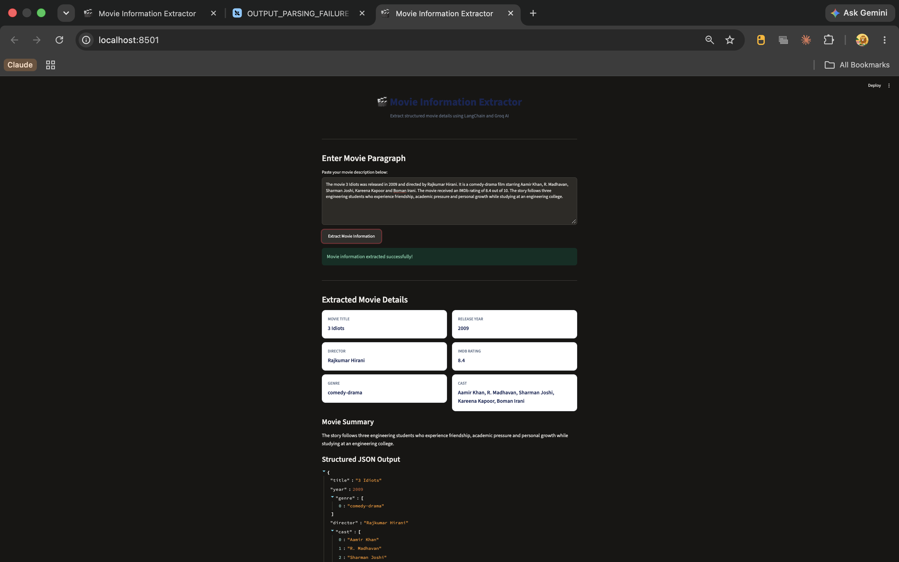
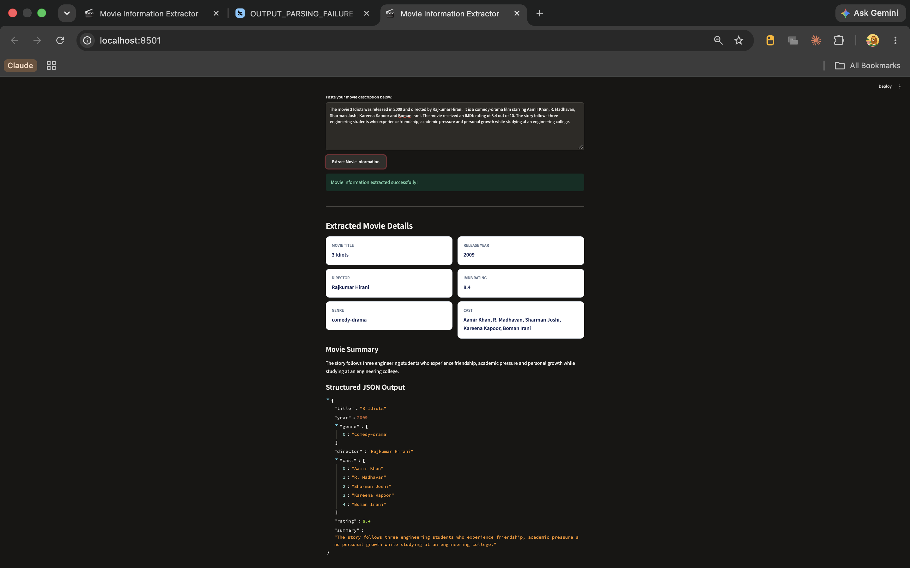

# Prompt Template & Structured Information Extraction

An AI-powered information extraction project built using **Python, LangChain, Groq LLM, Pydantic, and Streamlit**. The application uses prompt templates to process natural-language paragraphs and extract meaningful information into structured formats.

## 🚀 Project Overview

This project demonstrates how Large Language Models (LLMs) can understand unstructured text and convert it into structured information using prompt engineering and Pydantic output parsing.

The project includes:
- Prompt-based information extraction.
- Structured data extraction using Pydantic.
- Movie information extraction from text paragraphs.
- AI-powered responses using Groq LLM.
- Streamlit-based user interface.

## ✨ Features

- **Prompt Templates:** Create reusable prompts using LangChain.
- **Structured Output:** Convert natural-language text into structured data.
- **Pydantic Validation:** Define and validate output fields using Pydantic models.
- **Groq Integration:** Generate responses using Groq-hosted language models.
- **Streamlit Interface:** Interact with the application through a web interface.
- **Error Handling:** Handle invalid or unexpected model responses.

## 🛠️ Technologies Used

| Technology | Purpose |
|---|---|
| Python | Programming language |
| LangChain | LLM application development |
| Groq API | Language model integration |
| Pydantic | Structured data validation |
| Streamlit | Web application interface |
| python-dotenv | Environment variable management |
| uv | Python dependency and environment management |

## 📁 Project Structure

```text
prompt-templete/
│
├── chatmodel/
│   ├── chat.py
│   └── structure.py
│
├── src/
│   └── prompt_templete/
│       └── __init__.py
│
├── images/
│   ├── chatbot-home.png
│   └── chatbot-response.png
│
├── app.py
├── README.md
├── requirements.txt
├── pyproject.toml
├── uv.lock
└── .gitignore
```

## ⚙️ Installation and Setup

### 1. Clone the repository

```bash
git clone https://github.com/pagaleatharva/Prompt-Template-Project.git
```

### 2. Navigate to the project directory

```bash
cd Prompt-Template-Project
```

### 3. Create a virtual environment

```bash
uv venv
```

### 4. Install dependencies

```bash
uv sync
```

Alternatively, use:

```bash
uv pip install -r requirements.txt
```

### 5. Configure your Groq API key

Create a `.env` file in the project root directory:

```env
GROQ_API_KEY=your_groq_api_key
```

Get your API key from [Groq Console](https://console.groq.com/keys).


## ▶️ Run the Project

### Run the Streamlit application

```bash
uv run streamlit run app.py
```

### Run the chatbot

```bash
uv run python chatmodel/chat.py
```

### Run structured information extraction

```bash
uv run python chatmodel/structure.py
```

## 📸 Project Screenshots

### 1. Chatbot Interface



### 2. Chatbot Output


## 🎯 Learning Outcomes

Through this project, I explored:

- Prompt engineering and prompt template design.
- Working with Large Language Models.
- Integrating Groq API with LangChain.
- Structured output generation using Pydantic.
- Processing unstructured text into structured information.
- Building interactive applications using Streamlit.
- Managing Python dependencies and API keys securely.

## 👨‍💻 Author

**Atharva Pagale**

- GitHub: [pagaleatharva](https://github.com/pagaleatharva)
- LinkedIn: [Atharva Pagale](https://www.linkedin.com/in/atharva-pagale-224786296/)

---

⭐ If you find this project useful, consider giving it a star!
